<div align="center">

<a href="https://github.com/ishandutta2007/Awesome-Awesome-Awesome"></a>
<a href="https://discord.gg/jc4xtF58Ve"></a>
<a href="https://github.com/ishandutta2007/Awesome-AI-Developer-Assistant-Copilot/stargazers"></a>
<a href="https://github.com/ishandutta2007/Awesome-AI-Developer-Assistant-Copilot/network/members"></a>
<a href="https://github.com/ishandutta2007/Awesome-AI-Developer-Assistant-Copilot/issues"></a>
<a href="https://github.com/ishandutta2007/Awesome-AI-Developer-Assistant-Copilot/blob/main/LICENSE"></a>
<a href="https://github.com/ishandutta2007"></a>

<br/><br/>

<a href="https://github.com/ishandutta2007/Awesome-AI-Developer-Assistant-Copilot">
  
</a>

# 🚀 Awesome AI Developer Assistant & Copilot 🤖

### 🌟 *The Definitive Curated List of AI Pair Programmers, Autonomous Software Engineering Agents, AI-Native IDEs & Self-Hosted Coding Assistants* 🌟

[](https://github.com/ishandutta2007/Awesome-AI-Developer-Assistant-Copilot/pulls)
[](https://github.com/ishandutta2007/Awesome-AI-Developer-Assistant-Copilot/graphs/commit-activity)
[](https://github.com/ishandutta2007/Awesome-AI-Developer-Assistant-Copilot)
[](https://github.com/ishandutta2007/Awesome-AI-Developer-Assistant-Copilot)

</div>

---

## 📌 Executive Summary & Repository Overview

Welcome to the ultimate directory for **AI Developer Assistants**, **AI Copilots**, and **Autonomous Coding Agents**! 🎯

Software engineering has fundamentally shifted from manual boilerplate creation to **human-AI collaboration** and **agentic software development**. Whether you require enterprise-grade SaaS tools equipped with state-of-the-art frontier models (Claude 3.7/Sonnet, GPT-4o, Gemini 2.5 Pro) or 100% self-hosted, air-gapped open-source code copilots running locally via Ollama or vLLM, this repository indexes the best-in-class solutions with verified metrics, transparent pricing structures, and star counts.

### 🔍 Key Categories Covered:
- 🛠️ **Autonomous Software Engineering Agents**: Multi-step file planning, bash execution, and automatic bug fixing.
- ⚡ **AI-Native Code Editors & IDEs**: Editors built from the ground up for agentic workflows (VS Code forks, custom UI).
- 🔌 **IDE Extensions & Copilot Autopilots**: Seamless plugins for VS Code, JetBrains, Neovim, and Eclipse.
- 🔒 **Self-Hosted & Local LLM Coding Assistants**: Full privacy, air-gapped security, zero data retention, and custom model weights.
- 🧪 **API & Architecture Assistants**: Specialized agents for API design, debugging, unit test creation, and PR reviews.

---

## 📑 Table of Contents

- [📊 Sector Overview & Market Dynamics](#-sector-overview--market-dynamics)
- [🏢 SaaS & Hosted Commercial Platforms](#-saas--hosted-commercial-platforms)
- [🔓 Open-Source GitHub Projects](#-open-source-github-projects)
- [💡 Architectural Guide: How to Choose](#-architectural-guide-how-to-choose)
- [📈 Star History](#-star-history)
- [💖 Support & Sponsorship](#-support--sponsorship)
- [🤝 How to Contribute](#-how-to-contribute)
- [⚠️ Disclaimer & Security Considerations](#-disclaimer--security-considerations)

---

## 📊 Sector Overview & Market Dynamics

The AI developer assistant and copilot market is estimated at **$4.1 billion to $11+ billion in 2026**, growing at an aggressive compound annual growth rate (CAGR) of **23%–31%**. 

Structurally, the sector exhibits a **concentrated core with a highly fragmented innovation frontier**:
- 🏛️ **Enterprise Concentration (Hyperscaler Tier)**: Revenue and Fortune 500 deployments remain heavily concentrated among cloud titans (**GitHub/Microsoft** and **AWS Amazon Q**), leveraging corporate security compliance, SSO, and ecosystem bundling.
- ⚡ **Product & Agentic Innovation (Fragmented Frontier)**: Mindshare among active software engineers is intensely fragmented across disruptor AI-native IDEs (**Cursor**, **Windsurf/Cognition**) and open-source autonomous agent engines (**OpenHands**, **Cline**, **Goose**, **Aider**), continuously shifting as new foundation model reasoning capabilities emerge.

---

## 🏢 SaaS & Hosted Commercial Platforms

> **Enterprise Note**: All listed commercial products feature specific pricing and transparent tier limits. Sorted in descending order of parent company size, enterprise ARR, and valuation.

| Product | 🏢 Valuation / Market Cap / ARR | 💵 Pricing (Starting Paid Tier) | 🎁 Free Tier / Trial Limits | 🚀 Best For & Key Differentiators |
| :--- | :--- | :--- | :--- | :--- |
| **GitHub Copilot** | **~$3.94T Market Cap** *(Microsoft / GitHub: ~$2B+ ARR)* | **$10/user/month** *(Pro plan: $10 base + $5 flex usage credit; Pro+ $39/mo, Max $100/mo)* | **Free tier available**: Capped at 2,000 code completions/month, basic chat, and entry models (Claude Haiku, GPT-mini). | Seamless GitHub, VS Code, and JetBrains integration; unlimited inline completions on paid tiers. |
| **Amazon Q Developer** | **~$2.81T Market Cap** *(Amazon / AWS)* | **$19/user/month** *(Pro plan: 1,000 agentic requests, 4,000 lines of code/mo, SSO, data isolation)* | **Free tier available**: 50 agentic requests/month, code completions, and security vulnerability scans. | Best for AWS-centric teams needing deep cloud infrastructure integration and security scanning. |
| **Windsurf** | **~$10.2B–$26B Valuation** *(Cognition AI / Codeium: ~$490M+ ARR)* | **$15/user/month** *(Pro plan: 500 Cascade agent credits; Teams $30/user/mo)* | **Free tier available**: 25 credits/month (most generous permanent free allowance among AI IDEs). | AI-powered IDE with Cascade flow; low entry price for agentic coding. |
| **Replit AI** | **~$9B Valuation** *(~$150M+ ARR)* | **$20/month** *(Core plan: $20 cloud credits, full Agent, 1 parallel task, 5 collaborators)* | **Free tier available (Starter plan)**: Daily AI agent allowance, 1,200 dev minutes (20 hrs/mo), 1 vCPU, 2 GiB RAM, 1 published app. | Best for browser-based prototyping and full-stack autonomous application building. |
| **Postman AI Assistant** | **~$3.6B–$5.6B Valuation** *(~$313M+ ARR)* | **$14/user/month** *(Basic plan billed annually: AI actions at $0.04/credit; Solo at $0.05/credit)* | **Free tier available**: 50 AI Assistant credits/user/month for API generation, documentation, and testing. | Best for API developers seeking AI-driven endpoint testing, mock creation, and documentation. |
| **Cursor** | **~$2.5B–$9.9B Valuation** *(Anysphere: ~$1B ARR)* | **$20/month** *(Pro plan; India Start plan at ₹649/month; Ultra $200/mo)* | **Free tier available (Hobby plan)**: Capped at ~2,000 code completions/month and 50 slow/basic premium chat requests. | Purpose-built AI-first editor (VS Code fork) with deep agentic multi-file Composer workflows. |
| **Sourcegraph Cody** | **~$2.6B Valuation** *(~$50M ARR)* | **$9/user/month** *(Pro plan: unlimited chat, premium model choices)* | **Free tier available**: Unlimited autocomplete suggestions and 200 chats/prompts per month. | Codebase-wide awareness and multi-repo context for enterprise and individual developers. |
| **Tabnine** | **~$100M Valuation** *(~$27M ARR)* | **$39/user/month** *(Dev plan: agentic workflows, self-hosted/cloud options; +5% token pass-through)* | **90-day free trial** *(for Dev tier evaluation; former permanent free basic tier retired)*. | Privacy-focused AI code assistant with air-gapped and on-premises deployment for regulated industries. |

---

## 🔓 Open-Source GitHub Projects

> **Open-Source Guarantee**: All repositories below are community-maintained and open-source. Sorted strictly in descending order of **GitHub Star Count** ⭐.

### 1. **OpenHands** 
[](https://github.com/all-hands-ai/OpenHands/stargazers)
- **Repository**: [all-hands-ai/OpenHands](https://github.com/all-hands-ai/OpenHands) 🤖
- **License**: MIT
- **Primary Focus**: Fully autonomous AI software development agent capable of executing terminal bash commands, browsing the web, and editing files across complex codebases.
- **Key Highlights**: Dockerized runtime sandboxing, intuitive web UI, integration with GitHub issues/PR workflows, and plug-and-play LLM backend switching.

### 2. **Cline** 
[](https://github.com/cline/cline/stargazers)
- **Repository**: [cline/cline](https://github.com/cline/cline) 🦾
- **License**: Apache-2.0
- **Primary Focus**: The premier open-source autonomous coding agent for VS Code and JetBrains.
- **Key Highlights**: Human-in-the-loop permission prompts for terminal execution and file writing, MCP (Model Context Protocol) tool integration, zero vendor lock-in, and full support for local LLMs via Ollama and LM Studio.

### 3. **Goose** 
[](https://github.com/block/goose/stargazers)
- **Repository**: [block/goose](https://github.com/block/goose) 🪿
- **License**: Apache-2.0
- **Primary Focus**: High-performance, extensible Rust-based on-machine AI agent backed by the Linux Foundation's Agentic AI Foundation.
- **Key Highlights**: 70+ Model Context Protocol (MCP) integrations, desktop application for macOS/Linux/Windows, powerful CLI, and multi-model router capabilities.

### 4. **gpt-engineer** 
[](https://github.com/gpt-engineer-org/gpt-engineer/stargazers)
- **Repository**: [gpt-engineer-org/gpt-engineer](https://github.com/gpt-engineer-org/gpt-engineer) 🧠
- **License**: MIT
- **Primary Focus**: Specify what you want it to build, the AI asks clarifying questions, and then generates an entire codebase from scratch.
- **Key Highlights**: Rapid zero-to-one greenfield prototyping, structured design reasoning, and modular generation framework.

### 5. **Aider** 
[](https://github.com/paul-gauthier/aider/stargazers)
- **Repository**: [paul-gauthier/aider](https://github.com/paul-gauthier/aider) 💻
- **License**: Apache-2.0
- **Primary Focus**: Best-in-class terminal-based AI pair programming tool with automatic Git commits.
- **Key Highlights**: Whole-repository AST map for optimal context window efficiency, surgical multi-file diffing, git-aware workflow, and seamless terminal integration.

### 6. **Continue** 
[](https://github.com/continuedev/continue/stargazers)
- **Repository**: [continuedev/continue](https://github.com/continuedev/continue) ⏩
- **License**: Apache-2.0
- **Primary Focus**: The leading open-source autopilot extension for VS Code and JetBrains IDEs.
- **Key Highlights**: Inline code edits, contextual chat (@docs, @codebase, @git), custom slash commands (`/test`, `/comment`), and fully local storage of development logs.

### 7. **Tabby** 
[](https://github.com/TabbyML/tabby/stargazers)
- **Repository**: [TabbyML/tabby](https://github.com/TabbyML/tabby) 🐱
- **License**: Apache-2.0
- **Primary Focus**: Self-hosted AI coding assistant server — an open-source, on-prem alternative to GitHub Copilot.
- **Key Highlights**: Zero telemetry egress, self-hosted web dashboard, fast CUDA/ROCm/Apple Silicon inference acceleration, and native IDE plugins.

### 8. **Void** 
[](https://github.com/voideditor/void/stargazers)
- **Repository**: [voideditor/void](https://github.com/voideditor/void) 🌌
- **License**: Apache-2.0
- **Primary Focus**: The open-source alternative to Cursor — an AI-native code editor where you retain complete privacy and model choice.
- **Key Highlights**: Direct connection to your Ollama, Anthropic, or OpenAI API keys, multi-edit capabilities, and no proprietary proxy server intermediation.

### 9. **Roo Code** 
[](https://github.com/RooCodeInc/Roo-Code/stargazers)
- **Repository**: [RooCodeInc/Roo-Code](https://github.com/RooCodeInc/Roo-Code) 🦘
- **License**: Apache-2.0
- **Primary Focus**: Community-driven autonomous AI development extension for VS Code featuring custom agent modes (Architect, Code, Ask, Test).
- **Key Highlights**: Specialized personas with custom prompts, file-filtering controls, MCP server integrations, and detailed token consumption tracking.

### 10. **Wave Terminal** 
[](https://github.com/wavetermdev/waveterm) 
[](https://github.com/wavetermdev/waveterm/stargazers)
- **Repository**: [wavetermdev/waveterm](https://github.com/wavetermdev/waveterm) 🌊
- **License**: Apache-2.0
- **Primary Focus**: Open-source, AI-augmented terminal built for modern engineering workflows.
- **Key Highlights**: Inline graphical widgets, persistent workspaces, history search, and native LLM assistance directly in shell sessions.

### 11. **FauxPilot** 
[](https://github.com/fauxpilot/fauxpilot/stargazers)
- **Repository**: [fauxpilot/fauxpilot](https://github.com/fauxpilot/fauxpilot) ✈️
- **License**: Apache-2.0
- **Primary Focus**: An open-source, locally hosted GitHub Copilot server clone running on top of NVIDIA Triton.
- **Key Highlights**: Designed for air-gapped corporate data centers to serve completions directly into official GitHub Copilot extensions without external traffic.

---

## 💡 Architectural Guide: How to Choose

```
                               ┌─────────────────────────────────┐
                               │ What is your primary priority?  │
                               └────────────────┬────────────────┘
                                                │
                 ┌──────────────────────────────┴──────────────────────────────┐
                 ▼                                                             ▼
     [ Enterprise Ecosystem / SaaS ]                              [ Privacy / Self-Hosted / BYOK ]
                 │                                                             │
        ┌────────┴────────┐                                           ┌────────┴────────┐
        ▼                 ▼                                           ▼                 ▼
   (In-Editor)      (AI-Native IDE)                             (Terminal/Agent)   (Open IDE Plugin)
   • GitHub Copilot  • Cursor                                    • OpenHands        • Continue
   • Amazon Q        • Windsurf                                  • Aider            • Cline
                     • Replit AI                                 • Goose            • Roo Code
                                                                 • Tabby Server     • Void Editor
```

- **Choose GitHub Copilot** if your organization runs entirely within GitHub, Azure DevOps, and Microsoft 365, needing seamless enterprise single-sign-on (SSO).
- **Choose Cursor or Windsurf** if you want the highest velocity developer experience with specialized IDE controls, multi-file agentic Composer workflows, and deep context indexing.
- **Choose Cline or Roo Code** if you love VS Code / JetBrains and want full agentic execution while choosing between local Ollama models and BYOK frontier endpoints.
- **Choose Aider** if you are a terminal enthusiast who prefers concise, git-committed code refactoring in your command line.
- **Choose Tabby or FauxPilot** if your engineering requirements mandate strict compliance, zero external telemetry, and an on-premise GPU cluster.

---

## 📈 Star History

[](https://www.star-history.com/#ishandutta2007/Awesome-AI-Developer-Assistant-Copilot&type=date&legend=top-left)

---

## 💖 Support & Sponsorship

If this curated repository saved you hours of research or helped you discover your team's next AI development stack, please consider supporting the project:

- ⭐ **Star this repository** to help other developers find it on GitHub.
- 🍴 **Fork and share** with your engineering team and colleagues.
- ☕ **Buy me a coffee & become a sponsor**: Support ongoing maintenance, benchmarks, and updates via the [GitHub Sponsor Dashboard](https://github.com/sponsors/ishandutta2007).

---

## 🤝 How to Contribute

Contributions are welcome and highly appreciated! 🚀

1. 🍴 **Fork the repository**.
2. 🌿 **Create a new branch**: `git checkout -b feature/add-new-assistant`.
3. 📝 **Add or update the tool**:
   - Provide verified GitHub star counts or official enterprise pricing.
   - Include links to official repositories or project sites.
   - Maintain the existing tabular / markdown formatting.
4. 📬 **Submit a Pull Request** with a descriptive summary of your additions.

Check out [Awesome-Awesome-Awesome](https://github.com/ishandutta2007/Awesome-Awesome-Awesome) for more curated lists!

---

## ⚠️ Disclaimer & Security Considerations

- 🛡️ **Code Privacy & Security**: AI coding copilots and autonomous agents inspect, modify, and process proprietary source code. Always verify your company's data privacy policies before exposing enterprise codebases to third-party endpoints.
- 🔍 **Human-in-the-Loop Verification**: Generated code, shell scripts, and architectural diffs should always be audited with automated test suites and human peer reviews prior to production deployment.
- 📜 **Community Curated**: This repository is independently curated for educational and research purposes and is not affiliated with or endorsed by any commercial vendor.

---

<div align="center">
  <b>Built with ❤️ for developers worldwide building the future of software with AI.</b>
</div>
